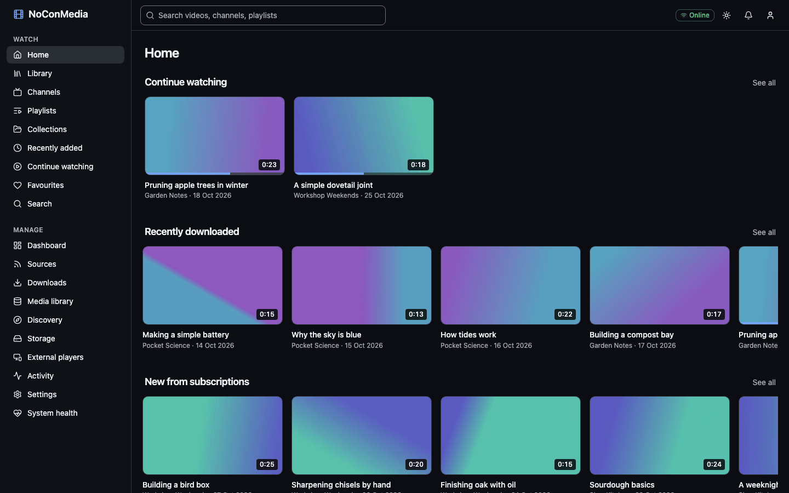
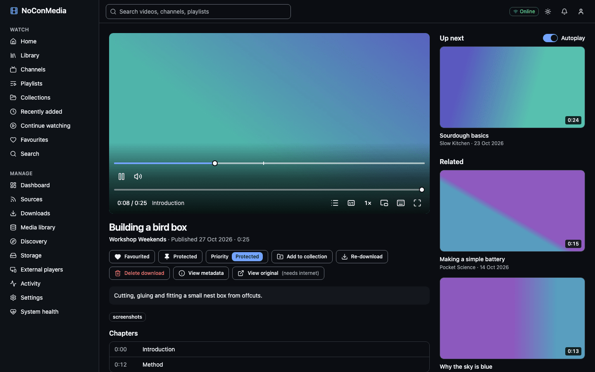
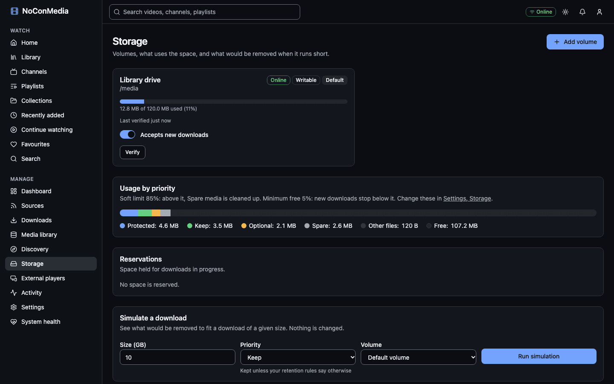

# NoConMedia

[](https://github.com/slaterjohn/nocon-media/actions/workflows/ci.yml)
[](LICENSE)

NoConMedia is a self-hosted, offline-first server that keeps a downloaded library of the YouTube channels and playlists you choose. It plays that library in a browser and in Xtream-compatible apps such as UHF on Apple TV, and it frees disk space automatically by priority: Protected, Keep, Optional and Spare.



## Who it is for

People who want a personal, local copy of the channels they follow, for a TV that has a poor connection, for a caravan or a holiday house, or because videos disappear. You run it on a Raspberry Pi or another small Linux machine, point it at an external drive, and it keeps the drive full of what matters without you clearing space by hand.

It is built for one administrator on a home network. It is not a public streaming service.

## Features

- **Sources.** Follow YouTube channels, playlists, single videos and search queries. Each source has its own check schedule, filters (keywords, duration, how many new videos per run), resolution, subtitle and audio-only options.
- **Priority-based storage.** Every source has a priority (Protected, Keep, Optional or Spare) and a retention rule such as "latest 10" or "last 30 days". When the drive passes the soft limit, the lowest-priority media is removed first. Protected media is never removed automatically, and every removal is recorded so it can be restored.
- **Storage simulation.** Preview what a download or a retention change would remove before committing to it.
- **Works offline.** Browsing, search, thumbnails, subtitles and playback use only the database and local files. The worker pauses downloads while the internet is down and resumes when it returns.
- **Removable drives.** A marker file on each volume tells NoConMedia whether the right drive is mounted. An unplugged drive pauses downloads and deletes nothing.
- **Web app.** Channels, playlists, collections, search, favourites, continue watching, and a player with subtitles, chapters, playback speed and keyboard shortcuts.
- **External players.** Separate Xtream Codes and M3U logins for each device, with rotation, revocation and a network allow-list.
- **Discovery (optional).** Recommendations with a budget and an approval queue, and Google Takeout watch-history import.
- **Operations.** Backup and restore scripts, a system health page and an offline readiness test.



## Quick start

You need 64-bit Linux, Docker Engine with Compose v2.24 or later, `git` and `openssl`. Docker must be usable without `sudo`.

```bash
git clone https://github.com/slaterjohn/nocon-media.git
cd nocon-media
cp .env.example .env
sed -i "s/^POSTGRES_PASSWORD=.*/POSTGRES_PASSWORD=$(openssl rand -hex 24)/" .env
sed -i "s/^NOCON_PROXY_SECRET=.*/NOCON_PROXY_SECRET=$(openssl rand -hex 32)/" .env
mkdir -p media data
sudo chown -R 1000:1000 media data
docker compose up -d --wait
```

Then open `http://<host>:3000` (use `http://localhost:3000` on the same machine) and follow the setup wizard. Keep the default storage path, `/media`, which maps to the `media` folder you just created.

Notes:

- There are no published images. The first `docker compose up` builds the API, worker and web images on your machine, which takes a few minutes on a desktop-class machine and noticeably longer on a Raspberry Pi. Later starts are quick.
- The `sed` lines use GNU sed, as on Linux. `scripts/install-pi.sh` does the same job (and checks Docker) if you prefer a script.
- To keep the library on an external drive, mount it first and set `MEDIA_PATH` in `.env` to the mount point. The [Raspberry Pi guide](docs/guides/install-raspberry-pi.md) covers formatting and mounting.
- To update later: `git pull`, then `docker compose up -d --build --wait`.

## Requirements

| | Minimum | Recommended |
|---|---|---|
| OS | 64-bit Linux (arm64 or amd64) | Raspberry Pi OS 64-bit Lite, Debian or Ubuntu |
| Hardware | Raspberry Pi 4 (4 GB) or any amd64 machine with 4 GB of RAM | Raspberry Pi 5, or a 4-core amd64 machine |
| Software | Docker Engine with Compose v2.24+ | |
| Library disk | Any ext4 drive | External USB SSD (a hard disk works, more slowly) |

32-bit operating systems are not supported. The default container limits are 512 MB for the API, 512 MB for the web app and 1 GB for the worker, plus PostgreSQL and Redis.

## Guides

- [Install on a Raspberry Pi](docs/guides/install-raspberry-pi.md): flash the OS, prepare a USB drive, install, cooling and power.
- [Install with Docker on other Linux machines](docs/guides/install-docker.md)
- [Sources](docs/guides/sources.md), [Storage and eviction](docs/guides/storage.md)
- [External players (Xtream and M3U)](docs/guides/xtream-clients.md) and [UHF on Apple TV](docs/clients/uhf.md)
- [Backup and restore](docs/guides/backup-restore.md), [Reverse proxy and HTTPS](docs/guides/reverse-proxy.md), [Working offline](docs/guides/offline.md)
- [Troubleshooting](docs/guides/troubleshooting.md) and the [environment variable reference](docs/reference/environment.md)

The full index is in [docs/README.md](docs/README.md).



## Connecting Apple TV and other Xtream apps

1. In the web app, open **Manage > External players** and add a player. Copy the password straight away, as it is shown once.
2. In UHF (or another Xtream app), add an Xtream Codes source.
3. Enter the server URL (`http://<host>:3001`), username and password from step 1.
4. Your downloaded videos appear under movies. Live TV and series stay empty.

Details, M3U playlists and network restrictions are in [External players](docs/guides/xtream-clients.md).

## Project status

NoConMedia is at version 0.1. It is feature-complete for its first release but has had limited real-world use.

- Tested with IPTVnator as an Xtream client.
- UHF on Apple TV has not been confirmed yet. The Xtream API passes automated conformance tests, and the [manual checklist](docs/clients/uhf.md) is waiting for a run on a real device.
- Raspberry Pi performance has not been measured. `scripts/benchmark.sh` exists, but no Pi results are recorded in [docs/benchmarks.md](docs/benchmarks.md).
- ARM64 and AMD64 images build, and the stack starts on an Apple Silicon host.
- The offline test passes (`scripts/offline-test.sh`: the whole stack on a network with no internet access).
- Automated tests use a fake yt-dlp, so downloads from live YouTube are not part of them. YouTube changes often; update yt-dlp now and then with `scripts/update-yt-dlp.sh`.

The evidence for each acceptance criterion is in [docs/acceptance.md](docs/acceptance.md).

## Legal

Only download content you have the right to download: your own uploads, content under licences that allow it, and material the owner has given you permission to keep. Downloading may breach YouTube's terms of service or copyright law where you live, and you are responsible for checking. NoConMedia does not circumvent DRM and will not be extended to do so. Respect the terms of any site you point it at.

NoConMedia is not affiliated with YouTube, Google or any Xtream client.

## Contributing

Bug reports, feature requests and pull requests are welcome. Read [CONTRIBUTING.md](CONTRIBUTING.md) first; [docs/development.md](docs/development.md) covers the local set-up.

## Security

Report vulnerabilities privately, not in a public issue. See [SECURITY.md](SECURITY.md). By default the stack is meant for a home network or Tailscale; do not expose port 3001 to the internet without a reverse proxy.

## Licence

NoConMedia is licensed under the [GNU Affero General Public Licence v3.0](LICENSE) (AGPL-3.0-only). If you run a modified version as a network service, the licence requires you to offer its source code to the people who use it.
