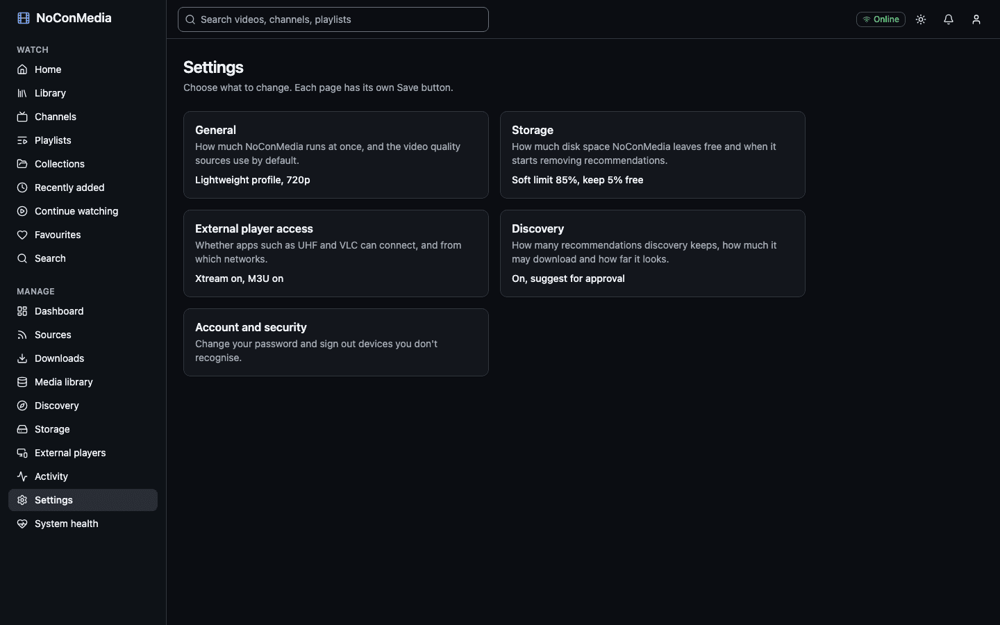
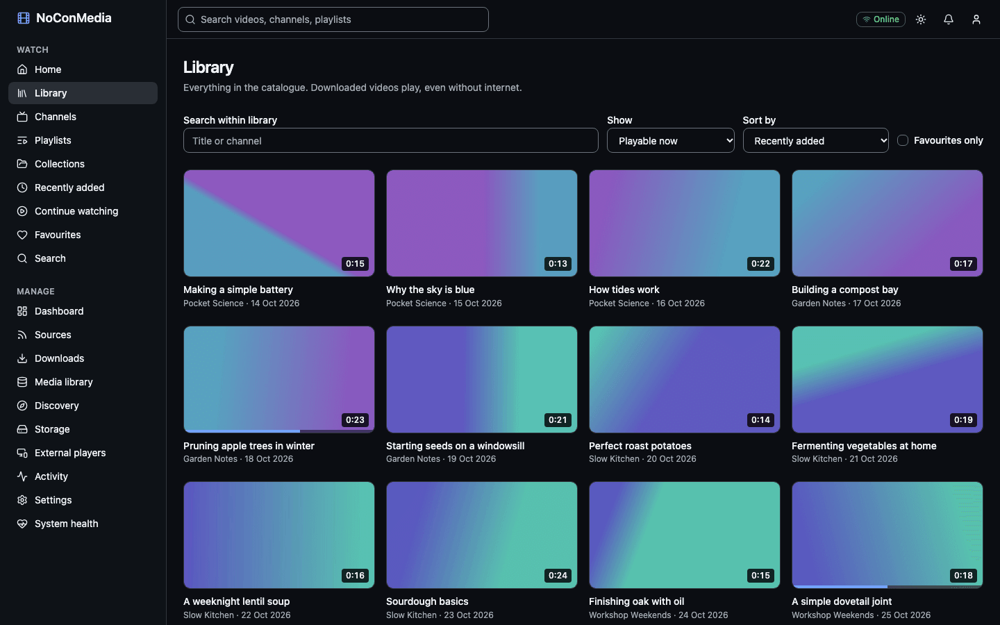

# Install with Docker Compose

This guide installs NoConMedia on a generic 64-bit Linux machine (AMD64 or ARM64). For a Raspberry Pi with a USB drive, use [Install on a Raspberry Pi](install-raspberry-pi.md), which covers the drive set-up in detail.

## Prerequisites

- A 64-bit Linux host. The compose file caps the app containers at 2 GB in total (API 512 MB, web 512 MB, worker 1 GB), plus PostgreSQL and Redis, so 4 GB of memory is a sensible floor.
- Docker Engine with Compose v2.24 or later (`compose.yml` uses an optional `env_file` entry). Check with `docker compose version`.
- `git` and `openssl`.
- A directory for the library with enough space for the video you intend to keep. Use a local ext4 volume where you can.
- A shell user who can run `docker` without `sudo` (add yourself to the `docker` group, then log in again).

```bash
docker compose version
openssl version
```

## Get the code

```bash
git clone https://github.com/slaterjohn/nocon-media.git
cd nocon-media
```

## Create the .env file

Either run the helper script or copy the example by hand.

The script copies `.env.example` to `.env`, fills in random values for `POSTGRES_PASSWORD` and `NOCON_PROXY_SECRET`, sets `MEDIA_PATH` and `DATA_PATH` to absolute paths, makes `.env` readable only by you, and creates the two directories. It never overwrites an existing `.env`. It does not use `sudo` and does not touch `/etc/fstab`.

```bash
scripts/install-pi.sh                      # uses ./media and ./data
scripts/install-pi.sh /srv/nocon/media /srv/nocon/data    # or choose the paths
```

To do it by hand:

```bash
cp .env.example .env
chmod 600 .env
openssl rand -hex 24      # paste as POSTGRES_PASSWORD
openssl rand -hex 32      # paste as NOCON_PROXY_SECRET
```

### Values to check

| Variable | What to do |
|---|---|
| `POSTGRES_PASSWORD` | Required. `docker compose` refuses to start without it. Use a random value. The default `change-me` works but is not safe. |
| `NOCON_PROXY_SECRET` | Random, 32 characters or more. It lets the API trust the client IP that the web container forwards. Without it, every browser login shares one rate-limit bucket. |
| `MEDIA_PATH` | Host directory for the library. It appears as `/media` in the containers. Default `./media`. |
| `DATA_PATH` | Host directory for temporary files and caches. It appears as `/data`. Default `./data`. |
| `DEPLOYMENT_PROFILE` | `lightweight` (default) runs one download and one conversion at a time. `standard` runs three downloads and two conversions. Only the default: the profile saved in the wizard or Settings wins. |
| `API_BIND`, `WEB_BIND` | `0.0.0.0` (default) publishes on every interface. Use `127.0.0.1` when a reverse proxy sits in front. |

Every other variable is optional. See the [environment reference](../reference/environment.md).

## Directory ownership

The containers run as UID 1000. Both host directories must be writable by that user, or the API reports "permission denied" and the setup wizard cannot save the storage location.

```bash
mkdir -p media data
sudo chown -R 1000:1000 media data
```

If your own user is UID 1000 (check with `id -u`), `chown` is not needed.

## Start the stack

```bash
docker compose up -d --build --wait
```

The first run builds three images and pulls PostgreSQL 17 and Redis 7. `--wait` returns when every container reports healthy. The worker waits for the API, because the API applies the database migrations on boot.

```bash
docker compose ps
```

All five services (`postgres`, `redis`, `api`, `worker`, `web`) should show `healthy`.

## First-run setup wizard

Open `http://<host>:3000`. A fresh install redirects to the setup page, titled "NoConMedia setup". It has nine steps. The page remembers progress: if you reload after creating the administrator, it resumes at the next unfinished step.

1. **Administrator.** Choose a username (at least 3 characters, default `admin`) and a password of at least 10 characters. Select "Create account".
2. **System checks.** Shows Database, Redis and Worker. Database and Redis must work to continue. A stopped worker only shows a warning. Select "Check again" after fixing anything.
3. **Storage.** Leave "Folder path" as pre-filled (`/media`, or your `MEDIA_ROOT`) and "Volume name" as "Main library", then select "Validate". The panel shows whether the folder exists, is writable, its mount point, filesystem, capacity and free space. If it warns that the folder looks like the container's own filesystem, the drive is probably not mounted; see [Troubleshooting](troubleshooting.md). Select "Confirm storage" to write the marker file and register the volume.
4. **Deployment profile.** Choose "Lightweight" or "Standard". The wizard preselects Lightweight, the right choice for a Raspberry Pi. The worker uses the profile you save here (and later in Settings); `DEPLOYMENT_PROFILE` in `.env` is only the default until one is saved, and `MAX_CONCURRENT_*` variables override either (see [environment reference](../reference/environment.md#deployment-and-concurrency)).
5. **Default quality.** Pick the default resolution (2160p down to 360p; 1080p is marked recommended). Each source can override it.
6. **Storage thresholds.** "Soft limit (% used)", default 85, and "Minimum free space (%)", default 5. The soft limit must be between 50 and 99, the minimum free between 1 and 50, and the soft limit cannot exceed 100 minus the minimum free. [Storage](storage.md) explains both.
7. **External players.** Switches for "Xtream Codes API" and "M3U playlist", both on by default. You create the logins later.
8. **First source (optional).** Paste a YouTube channel, playlist or video address, or a handle such as `@name`. "Check this source" tells you what NoConMedia recognised. Leave it empty to skip. The source is added with priority Keep, "keep everything", automatic eviction on, checked daily.
9. **Finish.** Review and select "Finish setup". The final screen offers "Open dashboard", "Add sources" and "Set up external players".

After setup, settings are in **Settings**, which links to a page for each group, and the sidebar groups pages under Watch and Manage.



Once sources have synced and downloaded, the library fills in:



## Upgrading

Pull or copy the new code, then rebuild and restart. The API applies any new database migrations on boot under a lock, so there is no separate migration step.

```bash
cd NoConMedia
scripts/backup.sh                       # always take a backup first
git pull
docker compose up -d --build --wait
docker compose ps
```

Rolling back a migration means restoring the backup taken before the upgrade; see [Backup and restore](backup-restore.md) and [Database migrations](../database-migrations.md).

To change only the yt-dlp version, use `scripts/update-yt-dlp.sh 2026.10.26` (any version in `YYYY.MM.DD` form). It rebuilds the worker, restarts it and writes `YTDLP_VERSION` to `.env`.

## Stopping and starting

```bash
docker compose stop        # stop, keep containers and data
docker compose start       # start again
docker compose restart worker
docker compose down        # remove containers; volumes (database) and your media stay
```

Do not add `-v` to `docker compose down` unless you want to delete the database volumes (`pgdata`, `redisdata`). Your media files in `MEDIA_PATH` are not Docker volumes and are not touched either way, but without the database the catalogue has to be rebuilt with Reconcile.

## Logs

```bash
docker compose logs -f worker        # downloads, sync, connectivity
docker compose logs -f api
docker compose logs --tail 100 web postgres redis
```

Each container keeps three 10 MB log files. Set `LOG_LEVEL=debug` in `.env` and run `docker compose up -d` to get more detail from the API and worker. The **Activity** and **System health** pages show recent errors without the command line.
