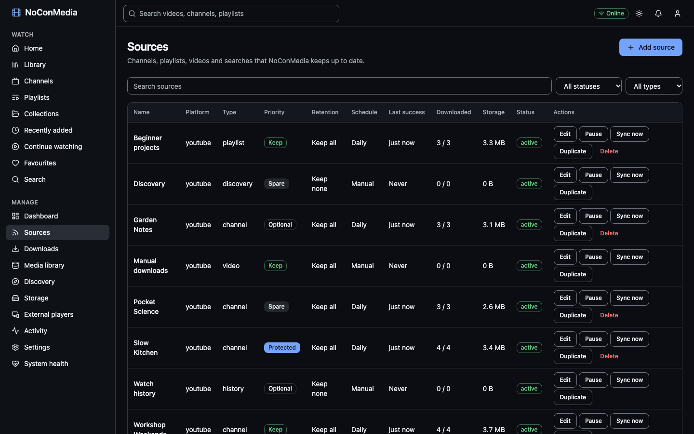
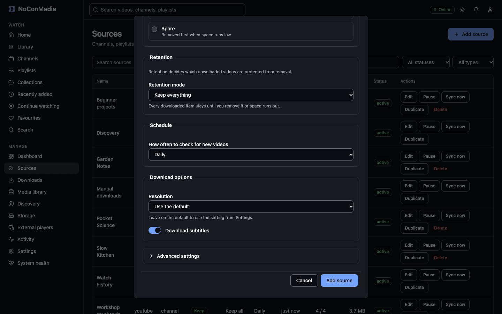

# Sources

A source is something NoConMedia keeps up to date: a YouTube channel, a playlist, a single video or a search query. The worker checks each source on its schedule, lists new videos, applies your filters and queues downloads. Manage sources under **Manage > Sources**.

Only download content you have the right to keep. See the legal note in the [README](../../README.md#legal).

## Adding a source

Select "Add source". Choose the "Source kind":

- "Channel, playlist or video address": paste a link or handle. NoConMedia checks it as you type and shows "Recognised a youtube channel: ..." when it understands it.
- "Search query": enter words to search for. Each run fetches the top results for the query (20 per run) and adds the ones that are new.

### Accepted address formats

Only YouTube is supported. Hosts accepted are `youtube.com`, `www.youtube.com`, `m.youtube.com`, `music.youtube.com` and `youtu.be`. The scheme can be left off.

| Type | Examples |
|---|---|
| Channel by handle | `@example` or `https://www.youtube.com/@example` |
| Channel by ID | `UCxxxxxxxxxxxxxxxxxxxxxx` (24 characters starting `UC`) or `https://www.youtube.com/channel/UCxxxxxxxxxxxxxxxxxxxxxx` |
| Channel, older styles | `https://www.youtube.com/c/Name`, `https://www.youtube.com/user/Name` |
| Playlist | `https://www.youtube.com/playlist?list=PLxxxxxxxx` |
| Single video | `https://www.youtube.com/watch?v=xxxxxxxxxxx`, `https://youtu.be/xxxxxxxxxxx`, `/shorts/ID`, `/live/ID` |

A link to a video inside a playlist (`watch?v=...&list=...`) is treated as the single video. Anything with a different host, a username or password in the URL, or an odd port is rejected with "This isn't a channel, playlist or video link that NoConMedia recognises".

To grab one video without creating a source of your own, use **Downloads > Download a video**. It is added to the built-in "Manual downloads" source at priority Keep (P1).

## Source settings

The form shows the essentials first. Filters and other rarely changed options sit under "Advanced settings", which starts collapsed.

The form shows the options most people need: address, name, priority, retention mode, schedule, resolution and subtitles. Everything else is under **Advanced settings**, which is closed until you open it: automatic eviction, the custom cron expression, filters, audio only, subtitle languages, discovery and target volume. A count such as "2 changed" on its header tells you when advanced values differ from the defaults.

### Name

Leave blank to use the name from the platform.

### Priority and retention

These decide what is removed first when the drive fills up and what is protected. Read [Storage and eviction](storage.md) before choosing. New sources default to Keep (P1) and "Keep everything". "Automatic eviction" lets this source's downloads remove lower-priority media to make room; switch it off if downloads should wait for space instead.

### Schedule

"How often to check for new videos":

| Choice | Behaviour |
|---|---|
| Once | One run, then no further runs. |
| Hourly, Daily, Weekly | Runs that long after the previous run. Daily is the default. |
| Custom cron | A five-field cron expression: minute, hour, day of month, month, day of week. |
| Manual only | Runs only when you select "Sync now". |

Cron examples:

| Expression | When |
|---|---|
| `0 3 * * *` | Every day at 03:00 |
| `30 2 * * 1` | Mondays at 02:30 |
| `0 */6 * * *` | Every six hours, on the hour |
| `15 1 1 * *` | The first day of each month at 01:15 |
| `0 22 * * 5,6` | Fridays and Saturdays at 22:00 |

Times use the worker container's clock, which is UTC unless you add `TZ=Europe/London` (or your zone) to `.env` and run `docker compose up -d`. A schedule check runs once a minute, so a source runs within about a minute of its time. Overdue sources are caught up a few at a time after downtime.

### Filters

Leave a field empty for no limit.

| Field | Effect |
|---|---|
| Maximum age (days) | Skip videos older than this. |
| Maximum historical videos | How many existing videos to import on the first run. |
| Minimum length / Maximum length (minutes) | Skip shorter or longer videos. |
| Maximum new videos per run | Cap on videos queued per check. |
| Preferred language | A code such as `en`. |
| Required keywords | Comma separated. A title must contain at least one. |
| Excluded keywords | Comma separated. Titles containing any are skipped. |
| Include Shorts, Include livestreams and recordings | Off by default. |

### Download options

- "Resolution": "Use the default" follows **Settings > General > Default resolution**. Otherwise pick 2160p down to 360p. NoConMedia asks for the best H.264/AAC MP4 at or below that height and falls back to whatever is available. YouTube offers H.264 only up to 1080p, so higher choices usually produce VP9 or AV1 files that some devices cannot play.
- "Audio only": saves space; videos play as audio with a still image.
- "Download subtitles", with "Subtitle languages" (for example `en, fr`) and "Include automatic captions" (less accurate).

### Discovery

"Discover from this source" turns on recommendations based on the source. The options are Depth (0 is this source only, 1 and 2 follow recommendations of recommendations), Mode and "Maximum recommendations". Modes:

- "Suggest for approval": recommendations wait in a queue.
- "Download automatically": recommendations within budget are queued at the lowest priority.
- "Catalogue only, no downloads": recommendations are listed but never fetched.

Global limits are in **Manage > Discovery > Discovery budget**: maximum depth, discovered and downloaded counts, a storage limit in GB, longest video, oldest video, minimum score (0 to 1), a cooldown for rejected videos, and an optional "Run every (hours)". The default interval is 12 hours on the lightweight profile and 3 hours on standard. "Run discovery now" starts a run immediately.

### Target volume

Where this source's media is stored. The default is the default volume.

## The approval queue

**Manage > Discovery** has tabs for Pending, Approved, Rejected, Queued and Catalogued recommendations. Each card shows the score, why it was suggested (the video that led to it, the strategy and the score components), and, for pending items, "Approve" and "Reject". Approving queues the download at priority Optional (P2). Rejecting stops that video being suggested again until the cooldown passes.

## Importing watch history from Google Takeout

Importing history gives discovery something to work from. The file is processed on your server.

To export from Google Takeout (Google changes this page now and then, so the labels may differ):

1. Go to <https://takeout.google.com> and sign in.
2. Choose "Deselect all", then tick "YouTube and YouTube Music".
3. Under that entry, open "All YouTube data included", deselect everything, and tick "history".
4. Under "Multiple formats", set the history format to JSON (HTML also works).
5. Continue to the next step, pick a one-off export, and create it. Google emails a link when the archive is ready.
6. Download the archive. You can upload the `.zip` as it is, or unzip it and upload `watch-history.json` or `watch-history.html`.

In NoConMedia, open **Manage > Discovery**, find "Import watch history", choose the file (up to 200 MiB) and select "Import". Leave "Queue downloads for the videos found" off to only seed recommendations; turn it on to download the videos too. The result shows Imported, Duplicates, Skipped, "Matched in library" and Queued. Importing the same file twice is safe: duplicates are counted and ignored.

## Cookies

Some videos only play when signed in (age-restricted, members-only, or when YouTube asks you to confirm you are not a bot). yt-dlp can use a Netscape-format `cookies.txt` exported from your own browser. Only use this for content you are entitled to watch with your own account. Cookies are a credential; keep the file private.

Each source can have its own cookies file. Open the source (its name in **Manage > Sources**) and find **Authentication cookies (optional)**. Choose a Netscape `cookies.txt` (up to 1 MiB) and select "Upload cookies"; select "Replace cookies" to swap it or "Remove cookies" to delete it. The section only shows whether cookies are set. The contents and the stored path are never shown again or returned by the API.

The upload is checked before it is saved: the first cookie lines must have seven tab-separated fields (domain, subdomains flag, path, secure flag, expiry, name, value). Anything else is rejected with an error.

The file is stored on the server at `secrets/source-<id>.txt` in `DATA_PATH` (`/data` in the containers), readable only by the app user (mode 0600, folder mode 0700). The worker passes it to yt-dlp as `--cookies` for that source's syncs and downloads. Deleting the source deletes the file; duplicating a source does not copy it. Activity records `source.cookies_updated` and `source.cookies_removed` without the contents.

Cookies expire. If a source starts failing with sign-in errors, export fresh cookies and upload them again.

## What "needs attention" means

A source is marked "Needs attention" after three failed runs in a row. It shows beside the source name, in the "Need attention" count on the dashboard, and as a "Source keeps failing" notification. The source keeps retrying with a growing delay (15 minutes, then 30, 60 and so on up to 24 hours; rate-limit errors wait at least an hour, increasing with each failure). One successful run clears the flag.

Open the source (the name is a link) to see recent runs and the last error. Common causes and fixes are in [Troubleshooting](troubleshooting.md#a-source-needs-attention-or-shows-yt-dlp-errors).

## Pausing, syncing, duplicating

Each row has Edit, Pause or Resume, "Sync now", Duplicate and Delete. A paused source does not run on its schedule, and "Sync now" is disabled while it is paused. Edits to priority and retention take effect straight away; other changes apply from the next run.

## Deleting a source

Select "Delete" and choose what happens to the videos it downloaded:

- "Keep the media": videos stay on disk at the source's priority and are protected from automatic removal.
- "Delete media only this source owns": files are removed but their catalogue entries and metadata remain. Videos that also belong to another source, are protected, or have a manual priority, stay.

The source itself is removed either way. The built-in sources (watch history, discovery and Manual downloads) cannot be deleted.
