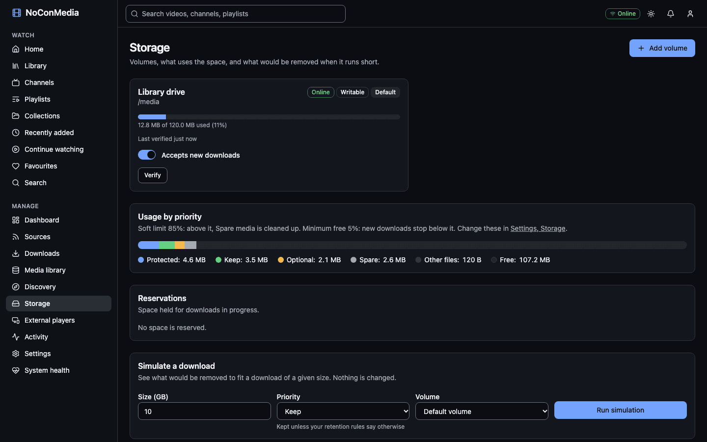

# Storage and eviction

NoConMedia keeps media on one or more volumes, watches how full they are, and removes the least important media when it needs room. This guide explains the rules from the user's side. The planner's exact algorithm is in [storage-management.md](../storage-management.md).

The Storage page shows each volume, how its space is used by priority, and a simulator.



## Volumes and the marker file

A volume is a folder on a drive that NoConMedia may fill with media. The setup wizard registers the first one (normally `/media` inside the containers). Each volume has a marker file:

```text
<volume folder>/.noconmedia/volume.json
```

It holds the volume's unique ID and name. The same folder also holds `.noconmedia/tmp/` (download staging, on the same filesystem so the final move is atomic) and `.noconmedia/manifests/` (library manifests written by Reconcile).

A volume counts as online only while the marker exists and its ID matches the database. This protects against the classic failure: a USB drive drops off, its mount point becomes an empty folder on the SD card, and the server starts filling the SD card. With the marker check, the empty folder has no marker, so the volume goes offline instead.

Registering a folder that already holds a marker (for example a library from an earlier install) re-attaches it and keeps its ID. The validation panel says "This folder already holds a NoConMedia library".

## Adding a volume

The Storage page (**Manage > Storage**) lists volumes with an Online or Offline badge, Writable or Read only, and a capacity bar. Select "Add volume", enter the "Folder path" and a "Name", select "Validate", then "Add volume".

Validation checks that the folder is inside an allowed media root, exists, is writable, and whether it sits on the container's own filesystem. It also reports capacity, free space and the mount point.

**Allowed roots are a limit.** The compose file mounts only `MEDIA_PATH` into the containers (as `/media`) and defaults `MEDIA_ROOTS_ALLOWED` to `/media`. A second drive therefore needs two changes: mount it into the api and worker containers, and allow its path. Set `MEDIA_ROOTS_ALLOWED=/media,/media2` in `.env` and add the mount in a `compose.override.yml` next to `compose.yml`:

```yaml
services:
  api:
    volumes:
      - /mnt/second-drive:/media2
  worker:
    volumes:
      - /mnt/second-drive:/media2
```

```bash
docker compose up -d
```

Then add `/media2` in the Storage page. This layout is not covered by the automated tests, so check it on a small library first. Do not add a subfolder of an existing volume as a second volume.

Per-volume controls:

- **Accepts new downloads** switch. Turn it off to stop filling a volume without taking it offline.
- **Make default** sets where sources without a chosen volume store their media.
- **Verify** re-reads the marker and free space immediately.

Each source can choose a "Target volume" in its settings. Eviction only removes media from the volume that the incoming download targets.

## Thresholds

Two numbers apply to every volume. Set them in the wizard or in **Settings > Storage**.

| Setting | Default | Allowed | Meaning |
|---|---|---|---|
| Soft limit (% used) | 85 | 50 to 99 | Above this, the lowest-priority media (Spare) is cleaned up in the background. Spare downloads also stop at this level. |
| Minimum free space (%) | 5 | 1 to 50 | Protected, Keep and Optional downloads may fill the volume until only this much is free. |

The soft limit cannot exceed 100 minus the minimum free. Free space is read from the filesystem, and downloads in progress hold a reservation for their expected size (the estimate plus 10% plus 64 MiB for processing) so two downloads cannot both claim the same space.

## Priorities

Every source has a priority. Media inherits the best (lowest-numbered) priority among the sources that include it.

| Label in the app | Code | What it means |
|---|---|---|
| Protected | P0 | Never removed automatically. |
| Keep | P1 | Kept unless your retention rules say otherwise. |
| Optional | P2 | Removed when Keep videos need room. |
| Spare | P3 | Removed first when space runs low. |

The app shows the labels. The codes (P0 to P3) appear in the API, the database and settings such as `DEFAULT_SOURCE_PRIORITY`.

In practice:

- **Protected.** Pinning a video makes it Protected. You can pin individual videos with the "Protect" button on the watch page.
- **Keep.** Subscriptions and manual downloads default to Keep. A Keep download may remove unprotected Keep, Optional and Spare media to fit, up to the minimum-free limit.
- **Optional.** Imported viewing history and approved recommendations default to Optional. An Optional download may remove unprotected Optional and Spare media. Media you have watched is lifted to at least Optional.
- **Spare.** First to go. Discovery recommendations default to Spare. A Spare download may remove only other Spare media, and Spare downloads stop at the soft limit.

A source's priority is chosen when you add it and can be changed later. Changing it recomputes the priority of its media straight away.

## Retention modes

Priority decides what goes first. Retention decides what is protected at all. Each source has one retention rule, and media protected by any of its sources is skipped by eviction.

| Mode (label in the form) | Protects |
|---|---|
| Keep everything (`all`) | Every downloaded video from the source. |
| Latest N videos (`latest_n`) | The newest N by publish date. |
| Last N days (`last_days`) | Videos published within N days. |
| Storage quota (`quota`) | The newest videos until their total size reaches the quota in GB. |
| Rolling window (`rolling`) | As latest N, and the older videos are also removed on a schedule (checked hourly), not only when space is short. |
| Prefer unwatched (`prefer_unwatched`) | Unwatched videos. Watched ones become removable first. |
| Keep nothing (`none`) | Nothing. Watch history and discovery sources use this. |

Note that "Keep everything" protects media from eviction. If every source protects everything and the disk fills, new downloads wait in "Waiting for storage" rather than removing anything.

## Automatic eviction

When a download needs more space than is available, the planner builds a list of media that may be removed, in this order:

1. Lowest priority first (Spare, then Optional, then Keep).
2. Media no source retains, before media protected only by an override.
3. Non-favourites before favourites.
4. Least recently watched, then least watched.
5. Oldest download first, then lowest recommendation score, then largest file.

Media is never a candidate if it is protected, retention-protected, being watched right now (a stream seen in the last 90 seconds), being processed, on a different volume, or the incoming source has "Automatic eviction" switched off.

If the eligible media would not free enough space, nothing is removed and the download waits. Eviction deletes the files but keeps the catalogue entry and metadata. The video shows as evicted, and a re-download cooldown applies (default 30 days, set in **Settings > Storage > Advanced settings**) so automatic sources do not fetch it again at once.

Besides on-demand eviction, the worker checks every 15 minutes whether any online volume is above the soft limit and cleans up Spare media down to it.

## Simulation

**Storage > Simulate a download** shows what would be removed without changing anything. Enter a "Size (GB)", a "Priority" and a "Volume", then select "Run simulation". The result shows the space required and available, the media that would be removed, the space reclaimable and the resulting free space, or a warning that not enough can be reclaimed.

When you edit a source, "Preview impact" shows how a new retention rule would change which media loses protection. Nothing is saved until you save the source.

## Eviction history and restore

**Storage > Eviction history** lists each removal: when, the title, the reason (for example soft threshold, rolling retention or manual), the priority it had, the space reclaimed and the status. Select "Restore" to queue the download again. Restoring clears the cooldown. Restore is only offered when the item can be downloaded again.

You can also remove a single video by hand. That uses the reason "manual" and keeps the metadata.

## Reconcile

**Storage > Reconcile with disk** compares what is on each online volume with the catalogue. It reads the `metadata.json` file beside each video and:

- Re-creates catalogue entries for videos that have files but no database row (after a restore or a move).
- Restores entries marked evicted or unavailable when their files are present.
- Reports missing files, orphan folders (a folder with no readable sidecar) and duplicates (the same video in two folders).

It never deletes files. "Dry run" is on by default and only reports. Switch it off and select "Reconcile now" to apply changes; a real run also writes a manifest to `.noconmedia/manifests/`. Run a dry run first.

The result shows a count tile for files found, rebuilt, missing files, orphans and duplicates. Missing files, orphans, duplicates and issues each have an expandable list underneath with the paths and keys involved. The same report is available from the API at `GET /api/storage/reconcile/<jobId>` while the job exists (finished jobs are kept for an hour).

## Missing drives

When a volume goes offline (marker missing or not matching, or the folder cannot be read):

- It turns Offline within about a minute and a notification is raised.
- Downloads that target it move to Paused with the reason "volume_offline". Nothing is deleted and nothing is written elsewhere.
- Videos on it show as temporarily unavailable and are hidden from Xtream clients.
- When the marker returns, the volume turns Online and paused downloads resume.

After you reconnect a drive, check it with **Verify**. If the host mount is back but the volume stays offline, restart the containers that hold the mount: `docker compose restart api worker`.

## Multiple volumes

New downloads go to the source's "Target volume", or the default volume. If the chosen volume is offline, read-only or no longer accepts new downloads, the worker uses another online, writable volume that accepts new downloads. Capacity bars and the "Usage by priority" chart on the Storage page add all volumes together; thresholds are applied per volume.

## Network shares (NFS and SMB)

NoConMedia works with a local filesystem and does not test network shares. If you use one:

- **Marker:** a share that unmounts leaves an empty mount point, which the marker check handles. A share that hangs instead of unmounting can stall reads; mount with options that fail rather than block (for NFS, a `soft` or bounded `timeo`/`retrans` setting, and `nofail` in fstab).
- **Locking and atomic moves:** downloads are staged in `.noconmedia/tmp` on the same share and renamed into place. This needs a filesystem that supports atomic rename and unprivileged writes by UID 1000. SMB mounts need `uid=1000,gid=1000` options; NFS needs matching ownership on the server (watch `root_squash`).
- **Free space:** the reported space must be accurate. Some shares report the whole pool or a stale figure, which makes thresholds meaningless.
- **Performance:** range requests and many small writes are slower over the network, and the Pi's Ethernet is shared with streaming. A local USB drive is the supported configuration.
