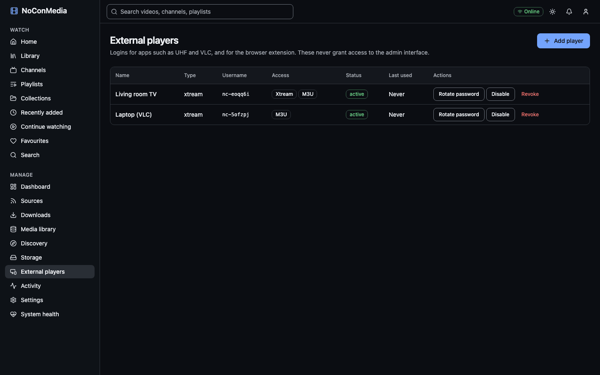

# External players (Xtream and M3U)

NoConMedia can serve your downloaded library to apps that support the Xtream Codes API or M3U playlists, such as UHF on Apple TV or VLC. The library appears as video-on-demand movies in categories. Live TV and series lists are empty so clients do not report errors.

## Concept

External players do not use your administrator login. Each player gets its own generated username and password, which can be disabled, rotated or revoked on their own. These logins never give access to the admin interface, and an admin session never works on the Xtream endpoints. Passwords are stored only as hashes and are shown once, when created or rotated.

Media is listed only if it is downloaded and its volume is online. Everything the client needs (the catalogue, artwork and the video files) comes from your server, so playback works with no internet.

## Create a player



1. Open **Manage > External players** and select "Add player".
2. Enter a "Name", such as "Living room TV".
3. Leave "Type" as "Media player (Xtream or M3U)". Keep "Allow Xtream" and "Allow M3U" ticked as needed. ("Browser extension" is a different kind of login used to record watch history; it does not work with media players.)
4. Select "Create". A dialog shows the Server URL, Username, Password and M3U URL. **Copy the password now.** It cannot be retrieved later. Select "I've saved the password" when done.

The table afterwards lists each player's type, username, whether Xtream or M3U is allowed, status, and when and from which IP address it was last used.

## Server URL

The URL has the form:

```text
http://<server-address>:3001
```

The address comes from the host name you used in the browser, so open the admin page with the name or IP your TV can reach (for example `http://nocon.local:3000`) before creating the player, or set `PUBLIC_XTREAM_URL` in `.env` to fix the value, for example `PUBLIC_XTREAM_URL=http://192.168.1.50:3001`. Streams and artwork URLs use the same base.

The port shown is `API_PORT_PUBLIC` from `.env` (default 3001), the same variable that sets the host port, so the URL follows if you change it. Set `PUBLIC_XTREAM_URL` instead when players reach the server through a different name or port, for example behind a reverse proxy.

Check that the server answers from another device on the network:

```bash
curl -s "http://nocon.local:3001/player_api.php?username=USER&password=PASS"
```

A valid login returns JSON with `user_info` and `server_info`.

## M3U URL

For apps without Xtream support, use the M3U URL from the dialog:

```text
http://<server-address>:3001/get.php?username=USER&password=PASS&type=m3u_plus&output=mp4
```

It returns one entry per playable video, grouped by category. The player needs "Allow M3U" and the "M3U playlist" switch in **Settings > External player access** to be on.

## Categories in the player

Recently added, Favourites, one per followed channel or playlist source, one per collection, and one per YouTube category tag (for example Music or Education). A video can appear in several.

## Rotate, disable, revoke

- "Rotate password" generates a new password and shows it once. The old one stops working at once. Update the player.
- "Disable" suspends a player; "Enable" restores it with the same password.
- "Revoke" deletes the login. The player stops working straight away. To use the player again, add it as a new one.

The "Last used" column helps you spot logins you no longer use.

## Restrict by network

By default the Xtream and M3U endpoints only answer clients on private addresses: `10.0.0.0/8`, `100.64.0.0/10`, `127.0.0.0/8`, `169.254.0.0/16`, `172.16.0.0/12`, `192.168.0.0/16`, and the IPv6 loopback, unique-local and link-local ranges. Others get HTTP 403 "This network is not allowed to use external player access."

To change the list, use either of:

- **Settings > External player access > Advanced settings > "Networks allowed for Xtream and M3U"**: one CIDR per line. This takes priority.
- `XTREAM_ALLOWED_CIDRS` in `.env`: comma separated, used only when the Settings list is empty.

```text
XTREAM_ALLOWED_CIDRS=192.168.1.0/24,10.8.0.0/24
```

`0.0.0.0/0` opens the endpoints to the whole internet. Do not do that without HTTPS and a good reason; the password is sent in the URL.

**Docker Desktop (macOS and Windows).** Published ports can reach the container with a source address that is not your LAN address, sometimes one that looks public. The default list then answers HTTP 403 even to players on your own network. Set `XTREAM_ALLOWED_CIDRS` (or the Settings list) to your LAN range, for example `192.168.1.0/24`, and look at the `lastIp` shown for the player under **External players** to see which address the server saw. Avoid `0.0.0.0/0` unless you understand the exposure described above. Turning off "Xtream Codes API" in Settings > External player access makes the endpoints return 404. Requests are rate-limited to 300 per minute per IP for the API and playlist endpoints, and 3,000 per minute for video streams.

## HTTPS

By default these endpoints speak plain HTTP on your LAN, and the password appears in URLs. That is acceptable on a trusted home network. To use HTTPS (for example for a VPN-less remote setup), put a reverse proxy in front of the API port and set `PUBLIC_XTREAM_URL=https://nocon-xtream.example.com`. See [Reverse proxy and HTTPS](reverse-proxy.md). LAN-only remains the default recommendation. Many TV apps accept a self-signed certificate poorly or not at all, so use a certificate from a public authority if you go this way.

## Which clients have been tested

IPTVnator 0.24.0 on macOS has been tested against real downloaded content and passed every checklist item: sign-in, categories, listings, artwork, metadata, playback, seeking, refresh and revocation (details in [MVP acceptance status](../acceptance.md)). The Xtream and M3U responses are also covered by automated conformance tests. UHF on Apple TV has not been tested yet; the checklist is in [UHF on Apple TV](../clients/uhf.md). VLC, TiviMate and other apps have not been tested. Treat any client not listed here as unconfirmed.
